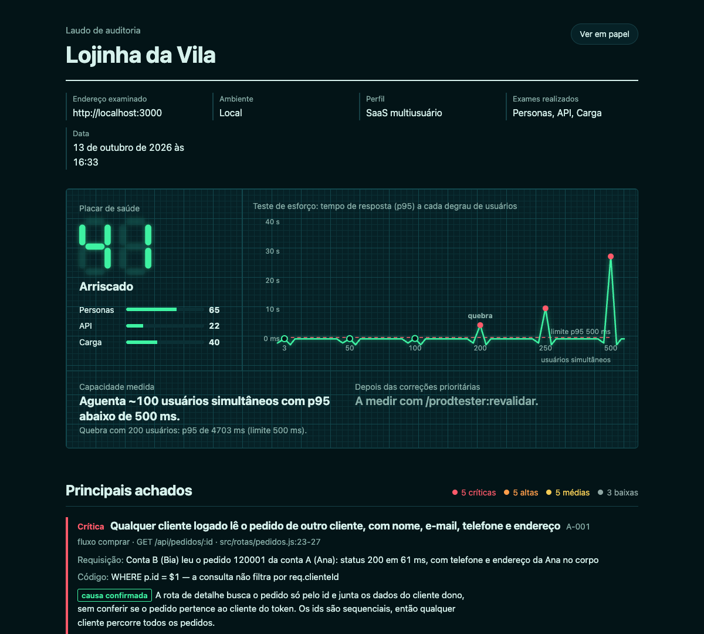
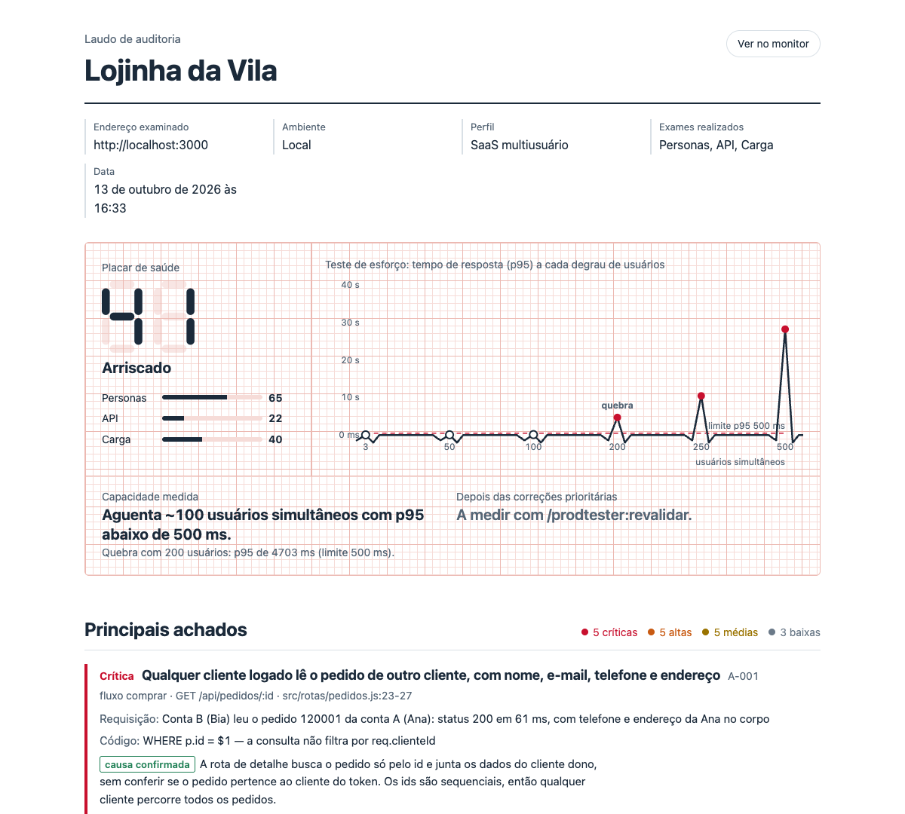
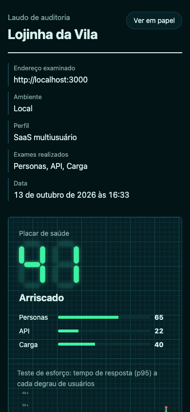
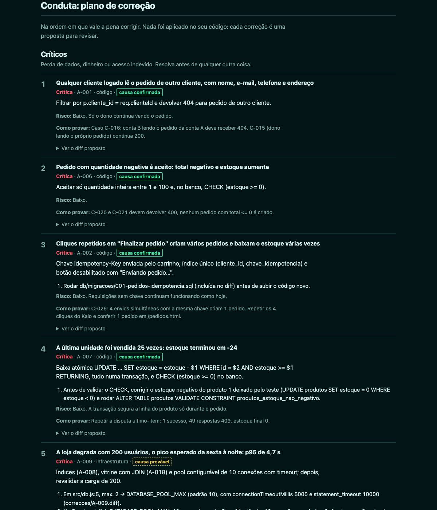

# prodtester

**Uma auditoria completa do seu sistema web antes que os seus usuários façam ela por você.**

O prodtester é um plugin do [Claude Code](https://code.claude.com) que examina um sistema em ambiente local ou de staging e entrega um laudo:

- **Personas sintéticas** navegam pelos fluxos como gente de verdade, ao mesmo tempo e cada uma no seu navegador: a Dona Cida que lê tudo, o Léo que não lê nada, a Jéssica no celular com 3G, o Marcos só no teclado e o Kaio que clica quatro vezes no botão de pagar.
- **Testes de API** em cada endpoint: caminho feliz, validação, autenticação, isolamento entre contas, idempotência e limites.
- **Teste de esforço** com [k6](https://k6.io), subindo os usuários em degraus até achar o ponto de quebra, mais cenários de disputa (o último item do estoque, o mesmo horário da agenda).
- **Diagnóstico e conduta:** causa raiz de cada problema (confirmada ou provável), a correção de boa prática no formato certo (diff, migração, passos de infraestrutura com custo) e o antes × depois medido quando você corrige.

Todo número do laudo vem de uma medição feita na auditoria. Nada é estimado.



## Instalação

No Claude Code:

```
/plugin marketplace add rodrigoscharp/prodTester
/plugin install prodtester@prodtester
/prodtester:auditar http://localhost:3000
```

O terceiro comando já começa a auditoria. Antes de testar qualquer coisa, o prodtester lê o projeto, propõe os fluxos críticos e pergunta, numa mensagem só, o que faltar: o endereço de teste, a autorização, o que é proibido e, se for rodar carga, a confirmação.

### Requisitos

| Para | Precisa de |
|---|---|
| Personas | Node.js 18 ou mais novo (com `npx`) e Google Chrome |
| API e carga | [k6](https://grafana.com/docs/k6/latest/set-up/install-k6/) instalado **ou** Docker aberto (usa a imagem `grafana/k6`) |

O que estiver faltando, o prodtester avisa no começo e segue com os exames possíveis.

## Comandos

| Comando | O que faz |
|---|---|
| `/prodtester:auditar [url]` | Auditoria completa: personas, API, carga, diagnóstico e laudo |
| `/prodtester:auditar-rapido [url]` | Dona Cida e Kaio nos fluxos críticos, API básica e correção só dos críticos |
| `/prodtester:auditar-carga [url]` | API e carga até o ponto de quebra, com plano de correção |
| `/prodtester:revalidar` | Refaz o que falhou na última auditoria e mostra o antes × depois |

Você também pode pedir com as suas palavras ("audita o meu sistema em localhost:3000"): a skill costuma entrar sozinha.

## O laudo

Cada auditoria gera `auditoria/<data-hora>/relatorio.html`, uma página única que abre offline, e `relatorio.md`, a mesma coisa em Markdown para colar num PR ou numa issue.

| Papel de eletrocardiograma | No celular |
|---|---|
|  |  |

O laudo traz:

- **Placar de saúde de 0 a 100**, com a fórmula escrita no próprio laudo: penalidade por severidade, nota por exame, média ponderada dos exames realizados e teto de 59 quando existe problema crítico;
- **Capacidade medida** ("aguenta ~100 usuários simultâneos com p95 abaixo de 500 ms") e o ponto de quebra;
- **Matriz fluxo × persona** e a linha do tempo de cada persona, com o que ela disse e os screenshots;
- **Tabela da API** (endpoint × check) e gráficos do teste de esforço;
- **Conduta:** o plano de correção priorizado (críticos, ganhos rápidos, estruturais), com o diff de cada correção;
- **Antes × depois**, quando você revalida;
- **Limites:** o que ficou de fora e por quê.



### O palco

Enquanto as personas navegam, cada uma narra o que está fazendo. Abra um segundo terminal com o comando que o prodtester mostra e assista ao vivo:

```
15:08:43  ⚡ Léo           › ⚠ Cliquei em Finalizar e veio “Algo deu errado.” Sem dizer o que fazer. Péssimo.
15:08:45  ⌨️ Marcos        › ⚠ Tab, tab, tab… o leitor só diz “botão”. Botão de quê? É o carrinho, sem nome.
15:09:25  👵 Dona Cida     › ✔ Pedido 120014 confirmado! Que alívio!
15:10:11  💥 Kaio          › ⚠ Quatro pedidos com o mesmo carrinho. Quebrou bonito.
```

Depois, `node <plugin>/skills/prodtester/scripts/palco.mjs <pasta-da-auditoria> --replay 2` reapresenta a sessão no dobro da velocidade.

## As personas

| | Persona | Como usa | Desiste quando |
|---|---|---|---|
| 👵 | Dona Cida, 67 | Lê tudo devagar, não entende jargão | 3 tentativas sem progresso |
| ⚡ | Léo, 24 | Não lê nada, clica no botão mais destacado | ~5 telas sem concluir |
| 📱 | Jéssica, 31 | iPhone SE com rede 3G, toca de novo quando demora | Tela parada por 15 s ou botão fora da tela |
| ⌨️ | Marcos, 45 | Só teclado, com leitor de tela | Elemento que o teclado não alcança |
| 💥 | Kaio, 19 | Clique repetido, voltar, recarregar, emoji no CPF, duas abas | Não desiste: testa robustez, nunca segurança |

Descreva o seu público ("dono de restaurante de 55 anos que só usa o celular") e o prodtester cria até duas personas sob medida.

## Configuração (opcional)

Coloque um `testes-fluxos.yaml` na raiz do projeto para não precisar responder às mesmas perguntas toda vez:

```yaml
versao: 1
sistema:
  nome: Minha Loja
  url_base: http://localhost:3000
  ambiente: local
contas_teste:
  - id: conta-a
    usuario_env: PRODTESTER_USUARIO_A
    senha_env: PRODTESTER_SENHA_A
  - id: conta-b
    usuario_env: PRODTESTER_USUARIO_B
    senha_env: PRODTESTER_SENHA_B
fluxos:
  - id: comprar
    nome: Comprar um produto
    critico: true
    inicio: /
    sucesso: Tela de confirmação com o número do pedido.
carga:
  pico_esperado_usuarios: 200
  momento_de_pico: sexta à noite
  hospedagem_producao: Render, 1 instância de 512 MB
```

O modelo completo e comentado está em [`skills/prodtester/templates/testes-fluxos.example.yaml`](skills/prodtester/templates/testes-fluxos.example.yaml). O prodtester detecta o tipo do sistema e adapta o plano: SaaS multiusuário (isolamento entre contas e picos), app local-first (volume de dados em vez de milhares de usuários) ou API pública (sem personas de navegador).

### Credenciais de teste sem expor senhas

Guarde as credenciais das **contas de teste** num arquivo fora do repositório e inicie o Claude Code apontando para ele:

```bash
PRODTESTER_SEGREDOS=~/segredos/minha-loja.env claude
```

As personas digitam o *nome* da chave (`PRODTESTER_SENHA_A`), o navegador troca pelo valor e esconde o valor nas respostas. Os testes de API e de carga leem o mesmo arquivo. Nenhuma senha vai para o laudo, os scripts ou os commits. Se preferir fazer o login você mesmo, exporte a sessão do navegador e use `PRODTESTER_SESSAO=<arquivo>`.

Os navegadores das personas abrem visíveis. Para rodar sem janelas (por exemplo, no CI), use `PRODTESTER_HEADLESS=true`.

## Segurança e limites

O prodtester segue estas regras em toda auditoria, e nenhuma configuração as desliga:

- **Nunca roda contra produção.** Só endereços locais ou de staging, e só com a sua confirmação de que você é o dono do sistema ou tem autorização dele.
- **Nunca roda carga sem confirmação** nesta execução, e só em ambiente que não divide banco, cache nem servidores com produção. O script de carga se recusa a rodar sem esses registros.
- **Nunca digita senhas reais** nem usa chaves que ignoram as regras de acesso (como a `service_role` do Supabase). Só contas de teste.
- **Pagamentos só em sandbox.** Nada de e-mail ou SMS para pessoas reais.
- **Nada de teste de segurança ofensivo:** sem injeção, força bruta ou fuzzing. O Kaio testa robustez; o isolamento entre contas usa só requisições legítimas.
- **Não altera o seu código nem a sua infraestrutura.** As correções são propostas. Se você pedir, elas são aplicadas numa branch separada, sem push.

**Aprovação automática.** Para as personas rodarem em paralelo sem dezenas de pedidos de permissão, o plugin traz um hook que aprova sozinho só três coisas: as ferramentas dos navegadores do próprio prodtester (exceto executar código arbitrário e enviar arquivos), os scripts do plugin que só mexem na pasta `auditoria/`, e a leitura de arquivos do próprio plugin. Tudo o que manda requisições ao seu sistema, como os testes de API e de carga, continua pedindo a sua aprovação.

**Limites honestos.** Staging não é produção quando a infraestrutura é diferente. Agentes de IA não são determinísticos, por isso cada achado vem com evidência. Personas não substituem testes com pessoas reais. Correções precisam de revisão humana. Tudo isso aparece no laudo.

## Experimente na loja-quebrada

A pasta [`demo/loja-quebrada`](demo/loja-quebrada) tem a Lojinha da Vila, uma loja em Node, Express e Postgres com 10 bugs plantados: pedido duplicado, estoque negativo em disputa, pedido de outro cliente visível, erro 500 em validação, pool de conexões pequeno e mais. Ela serve para conhecer o prodtester sem arriscar nada.

```bash
cd demo/loja-quebrada
docker compose up --build
```

Depois, no Claude Code, dentro dessa pasta, rode `/prodtester:auditar http://localhost:3000`. As contas de teste estão no [README da loja](demo/loja-quebrada/README.md).

Na [avaliação registrada](demo/avaliacao.md), a auditoria completa achou 9 dos 10 bugs na primeira rodada, incluindo os 5 críticos, e os 10 depois de um ajuste na persona Jéssica. O [gabarito](demo/gabarito-loja-quebrada.md) fica fora da pasta da loja, para a auditoria não "colar".

## Guarda contra regressão

No fim, o prodtester oferece copiar os testes gerados para a pasta `testes/` do seu projeto, junto com um job do GitHub Actions que roda os testes de API e o smoke de carga a cada pull request. O job falha quando um caso de API falha ou quando o smoke passa dos limites de tempo e erro.

## Custo e recursos

- Com o plugin ativo, o Claude Code sobe 7 servidores Playwright MCP (um por persona). Os navegadores só abrem quando uma persona começa a navegar.
- A lista de skills e agentes do plugin ocupa cerca de 1.100 tokens em cada sessão.
- Os agentes de persona usam o modelo Sonnet, para rodar até 7 em paralelo com custo menor.
- Uma auditoria completa leva dezenas de minutos. A maior parte é o teste de esforço, e o prodtester avisa antes de cada etapa quanto ela deve durar.

## Estrutura

```
.claude-plugin/        manifesto do plugin e do marketplace
skills/prodtester/     a skill: SKILL.md, personas, referências, modelos e scripts
skills/auditar*/       atalhos /prodtester:auditar, -rapido, -carga e /prodtester:revalidar
agents/                um subagente por persona
mcp/                   navegadores das personas (Playwright MCP) e a rede 3G da Jéssica
hooks/                 aprovação automática restrita aos navegadores e scripts do plugin
demo/                  a loja-quebrada, o gabarito e a avaliação
```

## Como contribuir

Contribuições são bem-vindas, principalmente novas personas, novos itens no catálogo de boas práticas e relatos de auditorias em stacks diferentes.

1. Abra uma issue descrevendo o problema ou a ideia.
2. Para testar uma mudança localmente, rode `claude --plugin-dir .` na raiz do repositório e valide com `claude plugin validate . --strict`.
3. Se mexer em personas, protocolo ou executores, rode uma auditoria na `demo/loja-quebrada` e confira que os 5 bugs críticos do gabarito continuam sendo encontrados.
4. Commits em português, no padrão Conventional Commits (`feat:`, `fix:`, `docs:`).

## Licença

[MIT](LICENSE) © Rodrigo Scharp
